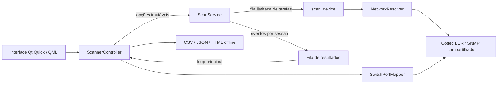

# IP Scanner Helper

Aplicação desktop em Python e PySide6 / Qt Quick para descobrir equipamentos IPv4, reunir um inventário com evidências de identificação e consultar tabelas MAC de switches. A versão 2.0 traz uma interface declarativa em QML, com a tabela como área principal.

O projeto distingue presença confirmada, fabricante estimado por OUI, categoria inferida e caminho observado em um switch. Informações que não puderam ser medidas permanecem explícitas no inventário.


## Demonstração

```powershell
python main.py --demo
```

A demonstração usa seis equipamentos fictícios na faixa de documentação `192.0.2.0/24`. Ela não consulta interfaces locais nem faz sondagens de rede. Exportação, filtros, propriedades e mapa ficam disponíveis; ações de rede são desativadas.

Um [exemplo de mapa HTML](docs/demo-topology.html) está incluído: baixe o arquivo e abra no navegador. Ele funciona offline, com busca, filtro de categoria, zoom, navegação por teclado e detalhes dos equipamentos.

## Funcionalidades

- Tabela de IPs como área principal, com controles compactos e indicadores discretos.
- Detalhes fechados por padrão; abertura pelo botão, duplo clique ou Enter, por escolha do usuário.
- Controles desenhados em QML, paleta neutra, acento verde discreto, tipografia consistente e ícone próprio.
- Tabela virtualizada: renderiza as células visíveis, com rolagem horizontal e vertical.
- Filtros de categoria, sem nome, sem MAC e categoria não identificada; busca por serviço e sem distinção de acentos.
- Colunas configuráveis, larguras ajustáveis e ordenação numérica de IP e latência, mantendo medições ausentes ao final.
- Opções avançadas recolhidas, tempo decorrido e consulta dos erros da execução.
- Entrada por IP, faixa ou CIDR, com validação antes de expandir a lista e limite de 4.096 alvos.
- Descoberta das interfaces IPv4 e suas máscaras reais no Windows, sem depender de acesso à internet.
- Modos rápido e completo, com concorrência configurável e cancelamento por execução.
- TCP não bloqueante com limite global de sockets e ICMP nativo do Windows, com fallback de compatibilidade.
- Presença por ARP atual, ICMP, conexão TCP ou resposta SNMP. O cache ARP sozinho não estabelece presença.
- Identificação por SNMP v1/v2c, DNS reverso, NetBIOS, certificados TLS/RDP, títulos Web, PJL, banners SSH/FTP, SSDP, SIP e ONVIF, conforme o modo e os serviços encontrados.
- Confiança qualitativa e evidência da categoria nas propriedades e exportações.
- Mapeamento de interfaces e tabelas MAC via IF-MIB, Bridge-MIB e fallback Q-BRIDGE-MIB; importação de texto e coleta Telnet legada.
- Coleta de switches sinalizada como parcial quando atinge um limite, encontra erro ou perde a continuidade dos OIDs.
- Exportação CSV com neutralização de fórmulas e JSON preservando metadados.
- Mapa HTML offline aberto no navegador padrão, com busca, pan, zoom e evidências dos caminhos aprendidos.
- Logs rotativos, sem registrar a comunidade SNMP ou a senha Telnet.

## Executar a partir do código

Requisitos: Windows 10/11 x64 e Python 3.11 ou superior. O ambiente local foi verificado com Python 3.14 e PySide6 Essentials 6.12. A aplicação utiliza `ping`, `arp`, `nslookup` e PowerShell do Windows.

```powershell
python -m venv .venv
.venv\Scripts\python.exe -m pip install -e .
.venv\Scripts\python.exe main.py --demo
.venv\Scripts\python.exe main.py
```

A instalação declara e instala o PySide6 Essentials, sem os módulos de navegador e multimídia. Também disponibiliza o comando:

```powershell
.venv\Scripts\ip-scanner-helper.exe --demo
```

Na aplicação, selecione uma interface ou informe a faixa manualmente, escolha o modo e inicie a varredura. Comunidade SNMP e consultas simultâneas ficam em **Opções**. Em janelas compactas, a seleção de interface também fica nessa área. A interface selecionada sugere a faixa e identifica o gateway local; as rotas do Windows determinam a interface efetivamente utilizada pelas sondas.

Selecione uma linha e use **Detalhes**, duplo clique ou `Enter` para abrir o painel lateral. Apenas selecionar uma linha mantém a tabela inteira visível. As abas distinguem a origem do nome da confiança da categoria. Use **Colunas** para escolher os campos; IP e nome permanecem disponíveis. Arraste a borda do cabeçalho para ajustar larguras. O botão direito reúne as ações de cópia, acesso e mapeamento de portas. Atalhos: `Ctrl+F` busca, setas navegam, `Enter` abre detalhes e `Esc` limpa os filtros. Veja os [detalhes sob demanda](docs/desktop-details.png), a [janela compacta](docs/desktop-compact.png) e o [mapeamento de switch](docs/desktop-switch.png).

O modo **Rápido** verifica presença, portas TCP comuns, SNMP, DNS e NetBIOS. O modo **Completo** acrescenta as sondas de identificação especializadas. O inventário exibe apenas equipamentos com resposta atual a pelo menos um dos métodos de presença.

O botão Parar solicita o cancelamento cooperativo. Consultas em andamento encerram pelo próprio timeout; a aplicação só libera uma nova varredura após a anterior encerrar. Resultados de sessões antigas são descartados.

## Testar

```powershell
.venv\Scripts\python.exe -m unittest discover -s tests -v
.venv\Scripts\python.exe scripts/smoke_ui.py
```

Os testes unitários e de regressão usam respostas simuladas. Cobrem BER/SNMP, comprimentos longos, validação de respostas, cancelamento e isolamento de sessões, exceções de tarefas, identificação por MAC, presença atual, RTT, certificados, limites de coleta, exportações e injeção de HTML.

O registro da migração Qt está em [docs/validation.md](docs/validation.md). O primeiro incremento de desempenho está documentado em [docs/benchmarks/README.md](docs/benchmarks/README.md), com resultados simulados reproduzíveis. A [validação da versão 2.0.1](docs/validation-2.0.1.md) registra os testes e as limitações dessa entrega.

O smoke test renderiza a interface QML real e testa cliques, teclado, detalhes, filtros, colunas, três larguras e mapeamento de switch. Os coletores de rede são substituídos por fixtures locais. Requer uma sessão gráfica disponível e fecha as janelas automaticamente. O workflow do GitHub Actions prepara os testes no Windows com Python 3.11 e 3.14; sua execução remota depende de publicar o repositório.

## Gerar o executável

```powershell
.venv\Scripts\python.exe -m pip install ".[build]"
.venv\Scripts\python.exe -m PyInstaller --noconfirm --distpath dist/portfolio/2.0.1 --workpath build/portfolio IP_Scanner_Helper.spec
```

Saída: `dist/portfolio/2.0.1/IP_Scanner_Helper/IP_Scanner_Helper.exe`. Distribua a pasta inteira, incluindo `_internal`. O usuário final não precisa instalar Python ou Qt. O arquivo `.spec` inclui QML, módulos Qt usados, ícone, template HTML e dados fictícios. O pacote é maior que o da versão Tkinter porque inclui o runtime Qt.

```powershell
dist\portfolio\2.0.1\IP_Scanner_Helper\IP_Scanner_Helper.exe --demo
dist\portfolio\2.0.1\IP_Scanner_Helper\IP_Scanner_Helper.exe --self-check
```

Para gerar os artefatos públicos da demonstração:

```powershell
python scripts/export_demo.py
```

Após validar o executável com `--self-check`, `python scripts/package_release.py` gera ZIPs separados de código-fonte e aplicação Windows, acompanhados por checksums SHA-256. O pacote de fonte usa uma lista explícita de pastas, excluindo o backup local, logs, ambientes virtuais e builds.

## Arquitetura



| Caminho | Responsabilidade |
| --- | --- |
| `core/scanner.py` | Coleta por equipamento e classificação por evidências |
| `core/scan_service.py` | Agendamento limitado, cancelamento, eventos e erros |
| `core/snmp.py` | Codificação BER, OIDs e validação de respostas SNMP |
| `core/resolver.py` | Sondas de rede e resolução de nomes |
| `core/switch_port_mapper.py` | IF-MIB, FDB, importação de tabelas e Telnet legado |
| `core/topology.py` | Modelo do mapa e serialização segura |
| `core/interfaces.py` | Endereços e prefixos locais do Windows |
| `core/exporters.py` | Exportações de inventário |
| `ui/qml/` | Tela declarativa, tema e controles visuais |
| `ui/qt_controller.py` | Estado da tela e entrega de resultados pelo loop Qt |
| `ui/qt_model.py` | Modelo da tabela virtualizada, com identidade por IP |
| `ui/qt_app.py` | Ciclo de vida Qt, recursos e autoverificação |
| `core/inventory.py` | Filtros, métricas, interpretação da origem e ordenação |
| `tests/` | Testes unitários e regressões sem varredura real |

O aplicativo e o executável utilizam Qt Quick. O código da interface Tkinter anterior foi removido. Consulte também [dependências e avisos de terceiros](THIRD_PARTY_NOTICES.md).

Detalhes das decisões e limites estão em [docs/architecture.md](docs/architecture.md). As correções desta versão estão em [CHANGELOG.md](CHANGELOG.md).

## Interpretação dos resultados

- **Latência:** RTT informado pelo ping. Um limite como `< 1 ms` é preservado como limite, sem inventar um valor numérico. Quando não há medição, o campo é `Não medida`.
- **Fabricante:** consulta exata à base OUI curada herdada do projeto. Ela não é uma cópia completa ou auditada do registro IEEE. Prefixos conflitantes foram removidos. MAC local ou privado não identifica fabricante nem categoria.
- **Categoria:** resultado de regras explícitas. RDP/SMB não comprovam Active Directory; DNS reverso não comprova que o DNS pertence a um AD. Confiança alta, média ou baixa descreve a evidência da regra, não uma probabilidade estatística.
- **Mapa:** linhas tracejadas representam agrupamento lógico. Uma linha contínua representa um MAC aprendido na porta consultada, podendo existir switches, APs ou outras pontes intermediárias. A aplicação não comprova conexão física direta.
- **Ausência de resposta:** pode indicar filtro, timeout, protocolo desativado, credenciais incompatíveis ou dispositivo indisponível. Não comprova que uma porta UDP está fechada.

## Limites e próximos passos

O foco é inventário IPv4 em Windows. ARP identifica vizinhos da sub-rede local; equipamentos de outras redes podem permanecer sem MAC. Os certificados TLS são coletados sem validação de confiança para identificação de equipamentos, portanto seus nomes são evidências declaradas pelo serviço. DNS via `nslookup` reconhece os rótulos de saída em português e inglês.

SNMP v3, GETBULK, IPv6, vizinhança LLDP/CDP, histórico persistente, comparação de inventários, regras manuais e descoberta completa de VLANs ainda não estão implementados. O fallback Q-BRIDGE não garante cobertura de todas as VLANs. Telnet existe para equipamentos legados e transmite credenciais sem criptografia; os comandos de coleta podem exigir adaptação ao fabricante.

Use somente em redes nas quais você tem autorização. A validação automatizada verifica o comportamento do software com fixtures; a interoperabilidade precisa ser verificada em equipamentos reais.

## Logs

Por padrão: `%LOCALAPPDATA%\IPScannerHelper\scanner.log`, até três cópias rotativas de 1 MB. Para alterar a pasta:

```powershell
python main.py --log-dir .\logs
```

Também é possível definir `IP_SCANNER_DATA_DIR`. Logs podem conter IPs e descrições dos equipamentos; eles, inventários privados, ambientes virtuais e executáveis gerados são excluídos pelo `.gitignore`.
