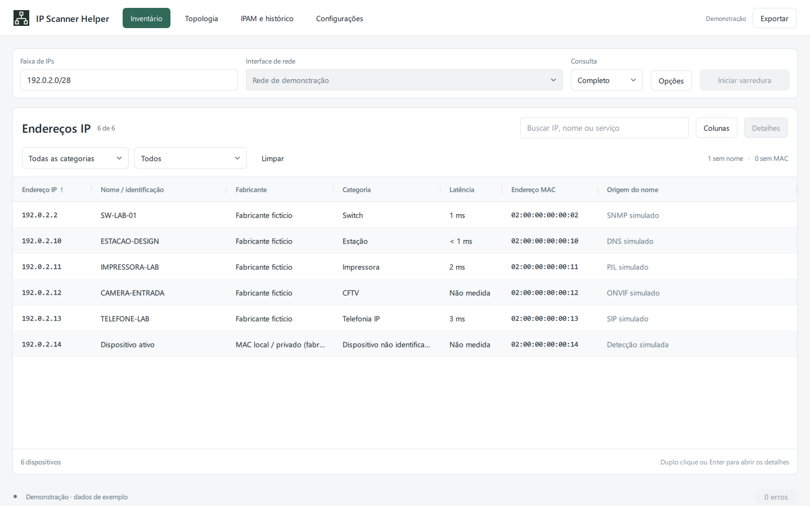

# IP Scanner Helper

Aplicação desktop em Python e PySide6 / Qt Quick para descobrir equipamentos IPv4, reunir um inventário com evidências de identificação e consultar tabelas MAC, vizinhos LLDP/CDP e VLANs de switches. A versão 2.1 organiza a interface QML em Inventário, Topologia, IPAM e histórico, e Configurações, com a tabela como tela inicial.

O projeto distingue presença confirmada, fabricante estimado por OUI, categoria inferida e caminho observado em um switch. Informações que não puderam ser medidas permanecem explícitas no inventário.



## Demonstração

```powershell
python -m ip_scanner_helper --demo
```

A demonstração usa seis equipamentos fictícios na faixa de documentação `192.0.2.0/24`. Ela não consulta interfaces locais nem faz sondagens de rede. Exportação, filtros, propriedades e mapa ficam disponíveis; ações de rede são desativadas.

Um [exemplo de mapa HTML](docs/demo-topology.html) está incluído: baixe o arquivo e abra no navegador. Ele funciona offline, com busca, filtro de categoria, zoom, navegação por teclado e detalhes dos equipamentos.

## Funcionalidades

- Tabela de IPs como área principal, com controles compactos e indicadores discretos.
- Quatro abas principais, preservando seleção, coleta ativa e a largura da tabela.
- Central de configurações com seções e temas claro, escuro e automático; [navegação e aparência](docs/navigation-and-appearance.md).
- Topologia nativa com grupos recolhíveis, zoom e arraste; mapa HTML detalhado também disponível.
- Mapa de endereços no IPAM, com estados observados, parciais, reservados e sem resposta.
- Detalhes fechados por padrão; abertura pelo botão, duplo clique ou Enter, por escolha do usuário.
- Controles desenhados em QML, paleta neutra, acento verde discreto, tipografia consistente e ícone próprio.
- Tabela virtualizada: renderiza as células visíveis, com rolagem horizontal e vertical.
- Presença publicada antes do fim da identificação; nome e serviços atualizados na mesma linha, com estado explícito de coleta incompleta.
- Filtros de categoria, sem nome, sem MAC e categoria não identificada; busca por serviço e sem distinção de acentos.
- Colunas configuráveis, larguras ajustáveis e ordenação numérica de IP e latência, mantendo medições ausentes ao final.
- Preferências persistentes de janela, tabela, última faixa e parâmetros de coleta; rascunho com salvar/cancelar e validação.
- Cinco perfis TCP incluídos e até oito personalizados; quinze tempos por sonda/lote ajustáveis, aplicados à próxima sessão.
- Cofre de comunidades SNMP protegido por DPAPI do usuário do Windows, com seleção explícita e ambiente opcional.
- Contexto de rede capturado por sessão, com ambiente opcional explícito e isolamento entre redes que usam a mesma faixa.
- Opções avançadas recolhidas, tempo decorrido e consulta dos erros da execução.
- Entrada por IP, faixa ou CIDR, com validação antes de expandir a lista e limite de 4.096 alvos.
- Descoberta nativa das interfaces IPv4 e suas máscaras reais no Windows, com fallback PowerShell e sem depender de acesso à internet.
- Modos rápido e completo, com concorrência configurável, orçamento cooperativo por IP e cancelamento por execução.
- Lista de coletas incompletas, preservando dados confirmados quando o limite de tempo é atingido.
- TCP não bloqueante com limite global de sockets e ICMP nativo do Windows, com fallback de compatibilidade.
- Presença por ARP atual, ICMP, conexão TCP ou resposta SNMP. O cache ARP sozinho não estabelece presença.
- Identificação por SNMP v1/v2c, DNS reverso, NetBIOS, certificados TLS/RDP, títulos Web, PJL, banners SSH/FTP, SSDP, SIP e ONVIF, conforme o modo e os serviços encontrados.
- Confiança qualitativa e evidência da categoria nas propriedades e exportações.
- Mapeamento de interfaces e tabelas MAC via IF-MIB, Bridge-MIB e fallback Q-BRIDGE-MIB; importação de texto e coleta Telnet legada.
- Consulta L2 sob demanda: LLDP/CDP, portas locais/remotas, correlação direcional e VLANs por porta com PVID/tagged/untagged; [uso e limites](docs/l2-discovery.md).
- GETBULK adaptativo com fallback GETNEXT, prazos e cancelamento nas consultas SNMP de switches.
- Coleta de switches sinalizada como parcial quando atinge um limite, encontra erro ou perde a continuidade dos OIDs.
- Histórico SQLite com reabertura offline, comparação de coletas compatíveis, reservas por ambiente e backup/restauração; [guia de uso](docs/history.md).
- Exportação CSV com neutralização de fórmulas e JSON preservando metadados.
- Mapa HTML offline aberto no navegador padrão, com busca, pan, zoom e evidências dos caminhos aprendidos.
- Logs rotativos, sem registrar a comunidade SNMP ou a senha Telnet.

## Executar a partir do código

Requisitos: Windows 10/11 x64 e Python 3.11 ou superior. O ambiente local foi verificado com Python 3.14 e PySide6 Essentials 6.12. A aplicação utiliza `ping`, `arp`, `nslookup` e PowerShell do Windows.

```powershell
python -m venv .venv
.venv\Scripts\python.exe -m pip install -e .
.venv\Scripts\python.exe -m ip_scanner_helper --demo
.venv\Scripts\python.exe -m ip_scanner_helper
```

A instalação editável disponibiliza o pacote de `src/` e instala o PySide6 Essentials. Também disponibiliza o comando:

```powershell
.venv\Scripts\ip-scanner-helper.exe --demo
```

O atalho de desenvolvimento `scripts\executar.cmd` usa o mesmo ambiente virtual e aceita opções como `--demo`. Ele funciona independentemente da pasta atual do terminal. Para usuários finais, use o executável do pacote Windows.

Na aplicação, selecione uma interface ou informe a faixa manualmente, escolha o modo e inicie a varredura. Comunidade SNMP, consultas simultâneas e limite de tempo por IP ficam em **Opções**. O padrão é 20 segundos por alvo; ao atingir o limite, os dados confirmados permanecem na tabela e os endereços afetados aparecem em **N incompletas** no rodapé. Em janelas compactas, a seleção de interface também fica nessa área. A interface selecionada sugere a faixa e identifica o gateway local; as rotas do Windows determinam a interface efetivamente utilizada pelas sondas.

Em **Configurações → Varredura**, defina modo, concorrência, limite por IP e sondas por segundo para a próxima varredura. A janela, colunas, larguras, ordenação e última faixa são lembradas automaticamente em `%LOCALAPPDATA%\IPScannerHelper\settings.json`. Credenciais e resultados ficam fora desse arquivo. Demonstração e autoverificação não leem nem gravam as preferências pessoais. Veja a [tela de preferências](docs/desktop-preferences.png) e o [contrato de persistência e contexto](docs/preferences-and-context.md).

Em **Configurações → Varredura → Sondas por segundo**, use 0 para desativar ou um valor de 1 a 1.000 para espaçar o início dos coletores de todos os IPs da sessão. A espera respeita o prazo por IP e pode resultar em coleta incompleta. Uma consulta TCP pode testar várias portas; o valor não representa pacotes por segundo. Veja o [alcance do controle](docs/probe-rate-limit.md).

O campo **Ambiente**, em Opções, permite dar um nome exclusivo à rede desta coleta. Ele começa vazio ao abrir o aplicativo. Sem ambiente informado, cada sessão fica isolada; o mesmo CIDR não estabelece a identidade de uma rede. O histórico usa esse contexto para separar e comparar coletas compatíveis.

As abas **Perfis TCP** e **Tempos** permitem escolher o escopo de portas e os limites das sondas. Duplique um perfil incluído ou crie um personalizado, com uma porta por linha. As consultas UDP específicas, como SNMP, continuam separadas. A migração das configurações 2.0.5 cria um backup antes de gravar o novo schema. Veja [perfis, tempos e retorno de versão](docs/port-profiles.md).

Em **Cofre SNMP**, cadastre a comunidade e selecione **Usar na próxima coleta**. O campo fica vazio ao editar; deixá-lo vazio mantém o segredo anterior. As operações do cofre são salvas pelos próprios botões. Em Opções, escolha a credencial ou **Entrada manual**. O `settings.json` guarda somente seu identificador; o arquivo protegido é separado. Veja [uso, proteção e recuperação do cofre](docs/credential-vault.md) e a [tela](docs/desktop-credential-vault.png).

Selecione uma linha e use **Detalhes**, duplo clique ou `Enter` para abrir o painel lateral. Apenas selecionar uma linha mantém a tabela inteira visível. As abas distinguem a origem do nome da confiança da categoria. Use **Colunas** para escolher os campos; IP e nome permanecem disponíveis. Arraste a borda do cabeçalho para ajustar larguras. O botão direito reúne as ações de cópia, acesso e mapeamento de portas. Atalhos: `Ctrl+F` busca, setas navegam, `Enter` abre detalhes e `Esc` limpa os filtros. Veja os [detalhes sob demanda](docs/desktop-details.png), a [janela compacta](docs/desktop-compact.png) e o [mapeamento de switch](docs/desktop-switch.png).

O **Mapa da rede** abre em árvore, com foco animado no switch, painel pesquisável de dispositivos, **Próximo switch** e **Visão geral**. Grupos e malha permanecem disponíveis; caminhos FDB não comprovam cabos. O menu **Exportar** inclui Draw.io/XML e Graphviz/DOT. Veja o [guia do mapa](docs/topology.md), a [visão geral](docs/topology-overview.png) e o [exemplo interativo com 129 equipamentos fictícios](docs/demo-topology-tree.html).

O modo **Rápido** verifica presença, portas TCP comuns, SNMP, DNS e NetBIOS. O modo **Completo** acrescenta as sondas de identificação especializadas. O inventário exibe apenas equipamentos com resposta atual a pelo menos um dos métodos de presença.

O botão Parar solicita o cancelamento cooperativo. O DNS nativo aceita solicitação de cancelamento; demais consultas encerram nos pontos de verificação ou no timeout restante. Chamadas nativas como `SendARP` podem ultrapassar o prazo antes de retornar; a aplicação só libera uma nova varredura após a anterior encerrar. Resultados de sessões antigas são descartados. Consulte os [contratos de tempo e DNS reverso](docs/scan-timeouts.md).

## Testar

```powershell
.venv\Scripts\python.exe -m unittest discover -s tests -v
.venv\Scripts\python.exe scripts/smoke_ui.py
.venv\Scripts\python.exe scripts/smoke_preferences.py
.venv\Scripts\python.exe scripts/smoke_navigation.py
.venv\Scripts\python.exe scripts/smoke_vault.py
.venv\Scripts\python.exe scripts/smoke_l2.py
.venv\Scripts\python.exe scripts/smoke_history.py
.venv\Scripts\python.exe scripts/smoke_topology.py
```

Os testes unitários e de regressão usam respostas simuladas. Cobrem BER/SNMP, comprimentos longos, validação de respostas, cancelamento e isolamento de sessões, exceções de tarefas, identificação por MAC, presença atual, RTT, certificados, limites de coleta, exportações e injeção de HTML.

A [validação 2.0.4](docs/validation-2.0.4.md) registra os prazos, DNS nativo e estados incompletos. A [validação 2.0.3](docs/validation-2.0.3.md) registra a organização em camadas, instalação e build. O registro da migração Qt está em [docs/validation.md](docs/validation.md). O primeiro incremento TCP está documentado em [docs/benchmarks/README.md](docs/benchmarks/README.md). A [validação 2.0.2](docs/validation-2.0.2.md) e o [benchmark do motor completo com coletores simulados](docs/benchmarks/engine.md) registram o fluxo progressivo, os testes e as limitações das medições.

O smoke test renderiza a interface QML real e testa cliques, teclado, detalhes, filtros, colunas, três larguras e mapeamento de switch. Os coletores de rede são substituídos por fixtures locais. Requer uma sessão gráfica disponível e fecha as janelas automaticamente. O workflow do GitHub Actions instala o pacote e executa os testes no Windows com Python 3.11 e 3.14. O layout `src/` permite testar o pacote instalado, sem depender de imports da raiz do repositório.

## Gerar o executável

A [validação 2.1.0](docs/validation-2.1.0.md) registra navegação, temas e central de configurações. A [validação 2.0.12](docs/validation-2.0.12.md) registra as correções de classificação. A [validação 2.0.11](docs/validation-2.0.11.md) registra histórico, comparação e restauração. A [validação 2.0.10](docs/validation-2.0.10.md) registra GETBULK, LLDP/CDP, VLANs e seus limites. A [validação 2.0.9](docs/validation-2.0.9.md) registra mapa, navegação e diagramas. A [validação 2.0.8](docs/validation-2.0.8.md) registra taxa, cancelamento e migração. A [validação 2.0.7](docs/validation-2.0.7.md) registra cofre, DPAPI e privacidade. A [validação 2.0.6](docs/validation-2.0.6.md) registra perfis, tempos e migração; a [validação 2.0.5](docs/validation-2.0.5.md), a base de persistência e contexto de rede.

```powershell
.venv\Scripts\python.exe -m pip install -e ".[build]"
.venv\Scripts\python.exe scripts/build_windows.py
.venv\Scripts\python.exe scripts/package_release.py
```

Saída: `dist/portfolio/2.1.0/IP_Scanner_Helper/IP_Scanner_Helper.exe`. Distribua a pasta inteira, incluindo `_internal`. O usuário final não precisa instalar Python ou Qt. A configuração em `packaging/windows/` inclui QML, módulos Qt usados, ícone, template HTML e dados fictícios. O build executa a autoverificação e usa a versão de `pyproject.toml` nos metadados e na pasta de saída.

```powershell
dist\portfolio\2.1.0\IP_Scanner_Helper\IP_Scanner_Helper.exe --demo
dist\portfolio\2.1.0\IP_Scanner_Helper\IP_Scanner_Helper.exe --self-check
```

Para gerar os artefatos públicos da demonstração:

```powershell
python scripts/export_demo.py
```

`scripts/package_release.py` exige o build validado, confere a identidade das fontes e do executável e gera ZIPs separados de código-fonte e aplicação Windows, acompanhados por checksums SHA-256. O ZIP de fonte exclui backups, estudos internos, arquivos locais de agentes, logs, ambientes virtuais e builds. Os artefatos de `dist/portfolio/` devem ser distribuídos por GitHub Releases; não entram no Git.

## Arquitetura

```text
src/ip_scanner_helper/
├── domain/           # Regras de identificação, inventário, alvos e topologia
├── application/      # Scanner, sessões, métricas e contratos
├── infrastructure/   # Windows, protocolos de rede, exportações e logs
├── presentation/     # Controlador Qt, modelo da tabela, QML e ícones
├── resources/        # Inventário fictício e template HTML compartilhado
├── bootstrap.py      # Construção e conexão das dependências
├── cli.py            # Argumentos e inicialização
└── __main__.py       # python -m ip_scanner_helper

tests/                # Testes por camada e regras de arquitetura
scripts/              # Execução, testes gráficos, benchmarks e distribuição
packaging/windows/    # Configuração PyInstaller e hook Qt
docs/                 # Arquitetura, decisões, validações e exemplos
```

O domínio concentra regras sem acesso à rede ou à interface. A aplicação coordena a varredura por contratos; a infraestrutura implementa os coletores. O controlador recebe os serviços explicitamente e atualiza a tabela pelo loop Qt. `bootstrap.py` conecta essas partes, sem iniciar sondagens na construção dos objetos.

As regras de dependência são verificadas pela suíte. O aplicativo usa imports do pacote instalado, sem ajustar `sys.path` em runtime, e funciona como executável Windows. O código da antiga interface Tkinter foi removido.

Consulte a [arquitetura](docs/architecture.md), a [decisão sobre a estrutura](docs/decisions/0001-modular-desktop-architecture.md), o [guia de contribuição](CONTRIBUTING.md) e os [avisos de terceiros](THIRD_PARTY_NOTICES.md).

## Interpretação dos resultados

- **Latência:** RTT informado pelo ping. Um limite como `< 1 ms` é preservado como limite, sem inventar um valor numérico. Quando não há medição, o campo é `Não medida`.
- **Fabricante:** consulta exata à base OUI curada herdada do projeto. Ela não é uma cópia completa ou auditada do registro IEEE. Prefixos conflitantes foram removidos. MAC local ou privado não identifica fabricante nem categoria.
- **Categoria:** assinaturas explícitas prevalecem sobre convenções de hostname; conflitos entre evidências do mesmo nível deixam a categoria inconclusiva. Fabricante, distribuição Linux, registro PTR e portas abertas não definem função sozinhos. RDP/SMB não comprovam Active Directory. Confiança alta, média ou baixa descreve a evidência da regra, não uma probabilidade estatística. Veja os [critérios e exemplos](docs/classification.md).
- **Mapa:** grupos são lógicos. Caminhos FDB aparecem em verde tracejado; relatos LLDP/CDP, em azul pontilhado. São evidências distintas, com origem e instante, sem comprovar cabeamento físico direto.
- **Ausência de resposta:** pode indicar filtro, timeout, protocolo desativado, credenciais incompatíveis ou dispositivo indisponível. Não comprova que uma porta UDP está fechada.

## Limites e próximos passos

O foco é inventário IPv4 em Windows. ARP identifica vizinhos da sub-rede local; equipamentos de outras redes podem permanecer sem MAC. Os certificados TLS são coletados sem validação de confiança para identificação de equipamentos, portanto seus nomes são evidências declaradas pelo serviço. O DNS reverso usa a API nativa com prazo e cancelamento; `nslookup` permanece como fallback quando a API não está disponível, reconhecendo os rótulos em português e inglês.

GETBULK, vizinhança LLDP/CDP, evidências de VLAN, histórico persistente e comparação de inventários estão disponíveis, com os limites descritos nos guias. Permanecem pendentes SNMP v3, inventário IPv6, regras personalizadas de reconhecimento e descoberta completa dos modos de porta/VLAN de todos os fabricantes. O fallback Q-BRIDGE não garante cobertura de todas as VLANs. Telnet existe para equipamentos legados e transmite credenciais sem criptografia; os comandos de coleta podem exigir adaptação ao fabricante.

Use somente em redes nas quais você tem autorização. A validação automatizada verifica o comportamento do software com fixtures; a interoperabilidade precisa ser verificada em equipamentos reais.

## Logs

Por padrão: `%LOCALAPPDATA%\IPScannerHelper\scanner.log`, até três cópias rotativas de 1 MB. Para alterar a pasta:

```powershell
python -m ip_scanner_helper --log-dir .\logs
```

Também é possível definir `IP_SCANNER_DATA_DIR`. Logs podem conter IPs e descrições dos equipamentos; eles, inventários privados, ambientes virtuais e executáveis gerados são excluídos pelo `.gitignore`.
