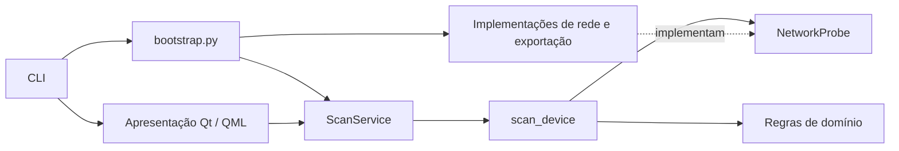

# Arquitetura e decisões

O aplicativo usa um único pacote em `src/ip_scanner_helper/`, organizado por responsabilidade. A decisão e seus limites estão em [0001 — Pacote src e separação de responsabilidades](decisions/0001-modular-desktop-architecture.md).

## Camadas e dependências

| Parte | Responsabilidade | Pode importar do projeto |
| --- | --- | --- |
| `domain/` | Classificação, inventário, alvos, interfaces e evidências de topologia | Domínio |
| `application/` | Varredura, sessões, observações e contratos | Aplicação e domínio |
| `infrastructure/` | Coleta de rede, APIs Windows, arquivos e logs | Infraestrutura, contratos da aplicação, domínio e recursos |
| `presentation/` | Estado Qt, modelo visual, QML e interação | Apresentação, aplicação, domínio e recursos |
| `resources/` | Dados fictícios e template HTML instaláveis | Biblioteca padrão |
| `bootstrap.py` | Construção das implementações e serviços | Aplicação e infraestrutura |
| `cli.py` | Argumentos, logs e inicialização da janela | Composição e apresentação |

`NetworkProbe` define as operações utilizadas pelo scanner. O coletor concreto é recebido por parâmetro, e `ScanService` recebe essa implementação por construtor. Os testes podem substituir o coletor sem importar Windows ou Qt na aplicação.

`DesktopServices` explicita descoberta de interfaces, exportações, mapa e coleta de switches. O controlador Qt recebe essas capacidades e um serviço de varredura; não importa coletores concretos nem os constrói. A fábrica em `bootstrap.py` apenas conecta os objetos, sem abrir sockets ou iniciar threads de rede.

`Preferences` e `WindowPreferences` são valores imutáveis e validados no domínio. O contrato `PreferencesStore` fica na aplicação; `JsonPreferencesStore`, na infraestrutura. A composição fornece o armazenamento ao ciclo de vida Qt, e o controlador recebe apenas o contrato. Demonstração e autoverificação dispensam esse armazenamento. A geometria e os monitores pertencem à apresentação. Consulte [preferências e contexto](preferences-and-context.md).

`tests/test_architecture.py` verifica limites de importação, ciclos e execução do pacote instalado fora da raiz. Não é necessário criar uma classe para cada função; regras puras permanecem funções, e os contratos existem nos pontos onde há uma implementação externa.

## Separação entre coleta e interface

`ScanOptions` é uma configuração imutável capturada antes da execução. Nenhuma tarefa de rede lê widgets ou propriedades Qt. `scan_device` recebe um endereço, opções, evento de cancelamento e um snapshot do cache ARP; retorna um registro ou `None`. Recebe o coletor por `resolver` e pode publicar presença parcial por `on_discovery`, antes do enriquecimento completo.

`NetworkContext` captura interface, endereço/prefixo, gateway, alvos e um ambiente opcional explicitamente informado. `ScanService.context` e o evento de conclusão expõem cópias defensivas dos metadados. Sem confirmação de ambiente, o escopo de comparação é exclusivo da sessão; com confirmação, inclui o identificador do ambiente e o hash dos alvos efetivos. Interface/CIDR isolados não autorizam reunir redes. O mapa dos resultados usa o gateway capturado, independente das escolhas feitas para a próxima coleta.

`ScanService` agenda até duas vezes o número de workers em tarefas pendentes. A lista de endereços é validada antes da alocação e possui limite de 4.096 destinos. Assim, a aplicação não materializa uma rede `/8` e não cria uma fila ilimitada de futures.

`ScanTimeouts` centraliza os limites de coleta e é parte das opções imutáveis. `ProbeContext` transporta prazos monotônicos e cancelamento até os adaptadores. O orçamento começa no worker do IP; fila e preparação da sessão ficam fora dele. Consulte [prazos e DNS reverso](scan-timeouts.md) para os limites cooperativos, resultados inconclusivos e liberação de callbacks tardias.

Cada execução recebe um identificador próprio e seu próprio evento de cancelamento. O serviço não aceita sobreposição. O consumidor descarta eventos de outras sessões. A parada cancela tarefas pendentes e solicita cancelamento às demais entre as operações de rede. Ela não interrompe uma função nativa no meio da chamada.

Todas as exceções das futures são lidas e transformadas em eventos de erro. A conclusão informa endereços analisados, total, erros, coletas incompletas e estado de cancelamento. Um esgotamento de tempo sem presença confirmada produz um evento `incomplete`, separado de um dispositivo confirmado ou erro. Nenhuma parada é promovida artificialmente a 100%.

Um `QTimer` do `ScannerController` consome até 200 eventos de varredura e 20 conclusões auxiliares por ciclo. Apenas a thread principal altera o estado Qt e o modelo da tabela. Tarefas auxiliares entregam dados por fila, com tokens que descartam resultados substituídos. A interface declara seus vínculos em QML e não executa sondas de rede.

## Evidências e identificação

`presentation/qml/Main.qml` concentra o layout e os detalhes; tema e controles reutilizáveis ficam em arquivos separados. `InventoryModel`, derivado de `QAbstractTableModel`, fornece as células para o `TableView`, que reutiliza os delegados visíveis. O controlador mantém a seleção por IP, por isso ordenar ou configurar colunas não altera o equipamento associado às ações. `domain/inventory.py` implementa busca, filtros e ordenação sem depender de Qt. Latências ausentes ficam ao final nas duas direções.

O painel lateral usa abas roláveis e começa fechado em qualquer largura de janela. A seleção simples não o abre; o usuário escolhe abrir pelo botão, duplo clique ou Enter. A tabela de IPs ocupa a largura disponível, e o painel só divide esse espaço enquanto estiver aberto. As opções de sondagem são capturadas no início da sessão, e seus controles ficam desativados durante a execução.

Uma entrada no cache ARP fornece somente um MAC anterior. O equipamento precisa responder agora a ARP, ICMP, TCP ou SNMP antes de entrar no inventário. Um MAC aproveitado do cache recebe essa origem explicitamente.

O nome prioriza `sysName`, DNS reverso, NetBIOS e certificado RDP, seguido das assinaturas de aplicação. Títulos de páginas e modelos não são tratados como comprovação de hostname. A origem permanece disponível no registro.

As regras de categoria são conservadoras e separadas do nome. Portas de impressão produzem confiança média; descrições SNMP específicas ou respostas PJL/ONVIF/SIP produzem confiança alta; RDP/SMB sozinhos indicam estação/servidor com confiança baixa. Não existe regra que declare Active Directory apenas pelo hostname ou por RDP.

A confiança é qualitativa. Não é uma avaliação de autenticidade criptográfica nem uma probabilidade calibrada. `visto_em` é registrado em UTC em formato ISO 8601.

## Protocolos

O codec SNMP compartilhado suporta comprimentos BER curtos e longos, OIDs com componentes em base 128, inteiros e os valores necessários às MIBs consultadas. Ele rejeita mensagens truncadas, comprimento indefinido, tags inesperadas e erros do agente.

As requisições usam IDs aleatórios e sockets UDP conectados ao destino. Uma resposta precisa ter o ID, versão e comunidade esperados. `sysName` e `sysDescr` são independentes: timeout de um não elimina o outro. Somente a comunidade configurada é consultada.

O walk compara componentes numéricos de OID, exige avanço estrito e verifica o limite da subárvore. Limites: 4.096 interfaces, 10.000 entradas de FDB e orçamento de 15 segundos por árvore. Resultados interrompidos são sinalizados como parciais. GETBULK e contextos por VLAN continuam no roadmap.

Certificados são lidos pela estrutura do subject ASN.1, sem confundir o CN do emissor com o nome do equipamento. A coleta TLS permite certificados locais não confiáveis; ela não autentica o equipamento.

## Mapas e exportações

`domain/topology.py` modela agrupamentos lógicos e caminhos aprendidos em tabelas MAC. Não cria switches fictícios ou distribui hosts arbitrariamente entre switches. Uma observação FDB não prova adjacência física direta.

O HTML incorpora o template instalado de `resources/templates/topology.html`, compartilhado sem depender de Qt, e JSON escapado contra fechamento de `script`. O JavaScript usa `textContent` e elementos SVG criados pela API do DOM, sem inserir dados coletados em `innerHTML`. Não há recursos de CDN. O mapa permite filtro, busca, pan, zoom e seleção por teclado.

CSV neutraliza células que poderiam ser interpretadas como fórmulas. Listas e dicionários são serializados como JSON nas células. A exportação JSON mantém os tipos e campos de evidência.

## Validação e fronteiras

Os testes de regressão exercitam pacotes e falhas simuladas, concorrência, cancelamento, coleta parcial, entradas hostis e contratos do controlador Qt. O smoke test carrega QML real e usa `QTest` para cliques e teclas, com fixtures no lugar dos coletores. Também verifica a tela de switches e três tamanhos de janela. Não representa uma homologação de fabricantes.

## Distribuição

`presentation/qt_app.py` resolve recursos a partir do próprio módulo, tanto no código quanto no diretório `_internal` do PyInstaller. O hook de `packaging/windows/hooks/` para QtQml inclui os módulos de QML, modelos, controles Basic, templates e layouts usados pela tela. Navegador embutido, multimídia, 3D e Tkinter ficam fora do executável. O HTML abre no navegador padrão do sistema. PySide6 Essentials é a única dependência de execução declarada; Shiboken é instalado por ela.

A interface e o ponto de entrada utilizam Qt Quick. Os módulos da antiga interface Tkinter foram removidos, junto com seus scripts e testes exclusivos.

A interface local informa faixa e gateway, mas as sondas seguem o roteamento do sistema operacional. A base OUI é curada e incompleta. SNMP v1/v2c e Telnet são protocolos legados; SNMP v3 e um coletor SSH são evoluções previstas, sem prometer suporte existente.

## Execução e manutenção

O comando instalado `ip-scanner-helper` e `python -m ip_scanner_helper` utilizam `cli.main`. O atalho `scripts/executar.cmd` é exclusivo do ambiente de desenvolvimento e utiliza `.venv`. A instalação editável substitui os antigos ajustes manuais de caminho.

`scripts/build_windows.py` constrói a distribuição versionada e executa `--self-check` com dados fictícios, a partir de uma pasta diferente das fontes. A versão do executável vem de `pyproject.toml`. O empacotamento só aceita um build cujo hash do executável e das fontes coincide com o registro de validação.

Histórico e agrupamentos futuros devem seguir as mesmas dependências: regras no domínio, coordenação na aplicação, persistência ou coleta na infraestrutura e interação na apresentação. As preferências básicas já usam essas fronteiras; perfis de portas e armazenamento protegido de credenciais permanecem pendentes.
