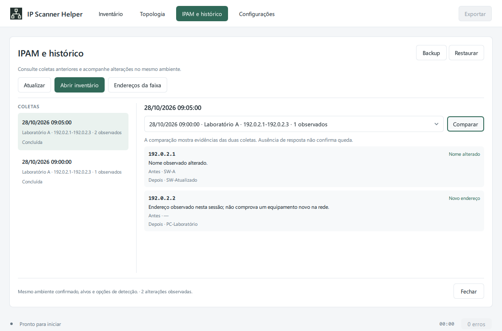

# Histórico e comparação — 2.0.11

A página **IPAM e histórico** abre as coletas salvas no computador. A tabela de IPs continua sendo a tela principal. Selecionar **Abrir inventário** recupera a coleta escolhida sem iniciar consultas de rede e identifica a visualização como histórica.

## Gravação

O histórico fica em `%LOCALAPPDATA%\IPScannerHelper\inventory.db`. O aplicativo salva início, contexto, alvos, opções não secretas, dispositivos, evidências e cobertura. Durante a execução, checkpoints são enviados no máximo uma vez por segundo; conclusão, interrupção e observações adicionais de switch também são registradas.

A escrita usa um worker próprio, fila limitada e conexões SQLite criadas na thread da operação. A interface recebe os resultados pela fila de eventos. No encerramento normal, a sessão ativa recebe estado interrompido e as gravações aceitas são drenadas, incluindo uma fila final limitada para o estado mais recente. Uma operação de armazenamento ainda em andamento pode manter o processo encerrando depois de fechar a janela.

Se o processo for encerrado à força ou o computador desligar, a última transação confirmada permanece disponível. Uma sessão sem encerramento registrado continua identificada assim; outra instância não a transforma automaticamente em concluída ou em equipamentos offline. Falhas de gravação são exibidas; **Atualizar** permite repetir tentativas retidas pelo aplicativo. Dados ainda não gravados permanecem apenas na memória da execução.

O SQLite usa esquema 2 e snapshots versão 1. A migração do esquema 1 cria um backup consistente antes da alteração. Arquivos desconhecidos, futuros, vazios ou inválidos são preservados e recusados. Não há reparo, expurgo ou retenção automática nesta versão.

O banco local não é criptografado. Comunidades, senhas e referências secretas não são armazenadas; opções e campos do inventário usam listas permitidas e metadados filtrados. O inventário e os backups contêm endereços e informações da rede. Demonstração e autoverificação não abrem o histórico pessoal.

## Comparar coletas

Antes de iniciar as coletas, abra **Opções** e informe um nome explícito em **Ambiente**. Use o mesmo identificador para o mesmo ambiente e nomes diferentes para redes distintas, mesmo quando usam a mesma faixa IP.

No histórico, selecione a coleta a consultar, escolha uma referência no seletor e pressione **Comparar**. A referência fornece o valor anterior; a coleta selecionada fornece o posterior. A comparação entre sessões diferentes exige:

- Mesmo ambiente confirmado e mesmo conjunto de alvos.
- Modo, perfil/portas, prazos e limite de sondas equivalentes.
- Cobertura suficiente para interpretar ausências e serviços.

São registrados novo endereço observado e alterações de nome, MAC e serviços TCP. Comparar por IP não estabelece uma identidade permanente do equipamento: uma alteração de MAC não confirma conflito nem troca física. Categorias e evidências são preservadas como vieram da coleta; o histórico não refaz a classificação de estações e servidores.

Uma ausência em coleta interrompida, com erro, alvos limitados ou dispositivos incompletos fica **inconclusiva**. Mesmo em uma coleta concluída, **Sem resposta** não significa queda confirmada nem IP disponível. Não há fusão automática de equipamentos por IP ou MAC.

## Endereços e reservas

**Endereços da faixa** mostra todos os alvos da coleta selecionada, inclusive os que não produziram um dispositivo no inventário. Os estados são Observado, Coleta parcial, Sem resposta, Não consultado ou Reservado manualmente. A visão padrão da tabela continua mostrando apenas dispositivos observados.

Reservas e tags são registros manuais separados das descobertas e vinculados ao ambiente confirmado. Selecionar um endereço preenche o formulário; **Reservar** grava a descrição e até 16 tags, e **Remover** exclui somente a reserva desse endereço nesse ambiente. Isso não configura DHCP nem altera equipamentos. Uma reserva pode coexistir com um dispositivo observado e não expira ao salvar outra coleta.

## Backup e restauração

**Backup** usa a API de backup do SQLite, verifica a cópia e publica o arquivo completo. Escolha um nome novo; backups existentes não são sobrescritos. Não copie somente o arquivo de banco durante uma operação de escrita.

**Restaurar** exige uma seleção de arquivo e confirmação. A operação valida aplicação, esquema, estrutura, integridade e conteúdo antes da substituição. O histórico atual é preservado em `inventory.pre-restore-<identificador>.sqlite`; o caminho aparece após concluir. Arquivos inválidos e falhas na substituição preservam o banco atual. Outra transação aberta ou arquivos de journal pendentes impedem a restauração. Restauração fica desabilitada durante uma varredura ou consulta de switch.

O backup reúne todas as sessões e reservas. A restauração substitui esse conjunto; não combina dois bancos. Ela não altera preferências nem o cofre de credenciais.

## Limites e validação

- Até 4.096 alvos e 16 MiB de snapshot por sessão; banco limitado a 256 MiB.
- A interface lista até 200 coletas recentes; o backup preserva todas as sessões armazenadas.
- Sem retenção automática, monitoramento agendado, certificação de IP livre ou homologação adicional de LLDP/CDP em rede real.
- Esquema SQLite validado, sem importação de dumps SQL arbitrários.

O [registro de validação](validation-2.0.11.md) descreve os testes de persistência, migração, isolamento, falhas, restauração e interface com arquivos temporários. O banco e seus arquivos auxiliares são excluídos do Git e dos ZIPs públicos.

## Navegação e mapa de endereços — 2.1.0

O histórico ocupa uma página principal. Em **Endereços da faixa**, alterne Lista/Mapa de endereços para consultar a mesma cobertura e editar reservas e tags. A grade é virtualizada e preserva observação, parcialidade e falta de resposta; não marca IP livre. Backup/restauração também estão em Configurações → Dados e arquivos. Veja [navegação e aparência](navigation-and-appearance.md).
