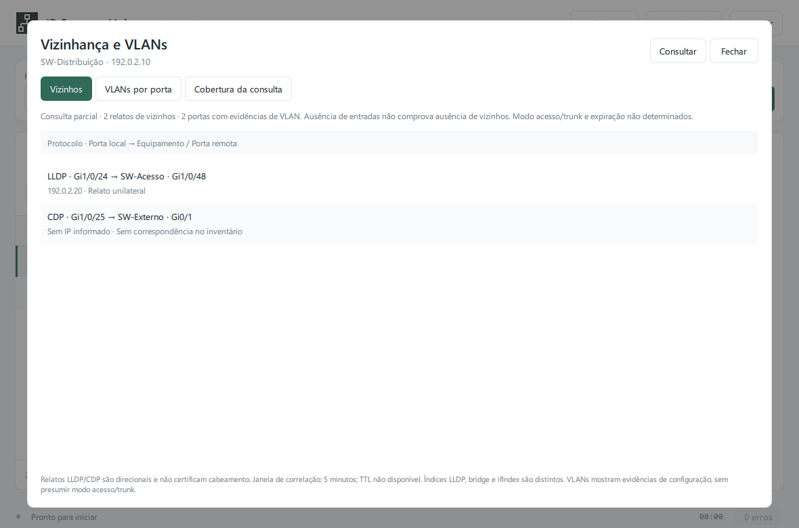

# Vizinhos e VLANs — 2.0.10

Selecione um equipamento no inventário, abra os detalhes e use **Consultar vizinhos e VLANs**. A mesma ação está no menu da linha. A consulta usa a comunidade SNMP manual ou a credencial selecionada no cofre, capturada antes de iniciar o trabalho. O botão **Interromper**, o fechamento do diálogo, uma nova varredura e a saída do aplicativo solicitam o cancelamento.

## Ler os resultados

- **Vizinhos:** protocolo, porta local, identidade/porta remota, endereço reportado e situação da correlação. LLDP e CDP permanecem separados, inclusive quando descrevem o mesmo equipamento.
- **VLANs por porta:** número da porta na bridge, `ifIndex`, PVID e VLANs de saída tagged/untagged. A ausência de correspondência entre índices é explícita. Listas incompletas recebem a indicação **parcial**.
- **Cobertura da consulta:** entradas, requisições, limites, erros, redução de lote e fallback por tabela. Um percurso concluído com zero entradas também pode indicar falta de suporte, permissões restritas ou protocolo desativado.

A consulta é somente leitura e atua no IP selecionado. Ela não percorre automaticamente os vizinhos, não tenta comunidades alternativas e não roda em todos os IPs do scanner. Não altera a configuração dos switches. O limite de admissões de coletores por segundo da varredura não se aplica a essa ação manual.

## Coleta e limites

O coletor L2 usa **SNMP v2c**, com orçamento total de 30 segundos, até 2,5 segundos e 4.096 variáveis por tabela. Cada requisição usa até 600 ms, respeitando o prazo restante. O cancelamento é cooperativo: uma recepção UDP já iniciada aguarda seu timeout. Não há suporte SNMPv3 nessa versão.

GETBULK começa com 12 repetições. `tooBig` reduz o lote; timeout, incompatibilidade ou resposta inválida permitem fallback GETNEXT, dentro do mesmo orçamento. O walker também aceita SNMPv1 com GETNEXT; o diálogo L2 não faz downgrade automático para v1. Término de MIB, saída da subárvore, OIDs repetidos/fora de ordem e limite de entradas têm tratamento próprio. O codec limita OIDs a 128 componentes de até 32 bits.

O mapeador MAC também usa esse walker, com orçamento global de 30 segundos, até 5 segundos por tabela e os limites próprios anteriores: 4.096 entradas de interfaces/bridge e 10.000 entradas FDB. Sua consulta SNMP também pode ser interrompida. Uma porta bridge sem mapeamento não recebe o nome da interface que por coincidência tenha o mesmo número.

| Informação | Objeto consultado |
| --- | --- |
| Identidade e portas LLDP locais | `1.0.8802.1.1.2.1.3` |
| Vizinhos LLDP | `1.0.8802.1.1.2.1.4.1.1` |
| Endereços de gerenciamento LLDP | `1.0.8802.1.1.2.1.4.2.1` |
| Cache CDP | `1.3.6.1.4.1.9.9.23.1.2.1.1` |
| Nomes/descrições de interfaces | IF-MIB `ifName`, com fallback `ifDescr` |
| Porta bridge → ifIndex | BRIDGE-MIB `dot1dBasePortIfIndex` |
| Participação corrente em VLANs | Q-BRIDGE-MIB `dot1qVlanCurrentTable` |
| PVID por porta bridge | Q-BRIDGE-MIB `dot1qPvid` |

Os bitmaps usam números de porta bridge, com o bit mais significativo indicando a primeira porta de cada octeto. Tagged é calculado por egress menos untagged somente quando ambos os bitmaps estão presentes e consistentes. PVID permanece uma informação separada; múltiplas VLANs não bastam para declarar modo trunk ou acesso. Não são consultadas MIBs proprietárias de modo de porta.

São aceitos bitmaps de até 4.096 portas e VIDs 802.1Q de 1 a 4.094. Índices de VLAN local acima desse intervalo não são convertidos em VIDs. Na tabela corrente, campos de versões diferentes da mesma VLAN não são combinados. O snapshot não é transacional: uma configuração modificada durante os walks pode produzir informação incompleta ou divergente.

## Correlação e mapa

IDs de chassi e porta preservam subtipo, valor legível e octetos originais. Um ID pode ser texto arbitrário; não precisa ser IP ou MAC. `lldpLocPortNum`, porta bridge e `ifIndex` são espaços distintos. A correlação LLDP com IF-MIB exige `interfaceName` e nome único exatamente igual; abreviações e números parecidos não são equiparados.

Endereços, chassis e MACs são comparados ao inventário. Candidatos conflitantes ficam **ambíguos**. Nome único é uma correspondência mais fraca e não estabelece reciprocidade. Um vizinho sem correspondência permanece nos detalhes, sem receber um IP ou uma aresta inventados. Endereços IPv6 reportados por LLDP são preservados; o inventário continua IPv4. No CDP, o coletor interpreta endereços IPv4; outros tipos permanecem indisponíveis.

**Relatos recíprocos** exigem os dois lados, mesmo protocolo/contexto, identidades suficientes, portas equivalentes nos dois sentidos e observações dentro de uma janela local de cinco minutos. Identidade divergente, portas divergentes e portas insuficientes são situações distintas. Reciprocidade não certifica cabeamento, estado operacional nem ausência de intermediários.

As MIBs consultadas não fornecem o TTL restante de cada anúncio. `expires_at` permanece desconhecido. A diferença entre `sysUpTime` e `TimeMark`/`LastChange`, quando válida, indica tempo desde alteração, sem representar idade do último anúncio ou expiração. A janela de cinco minutos é uma política de correlação do aplicativo.

Abra novamente **Mapa da rede** depois das consultas. Verde tracejado representa caminho FDB; azul pontilhado representa relato LLDP/CDP. O layout continua lógico e preserva direções, protocolos e múltiplas portas. Observadores genéricos podem ser explorados sem mudar sua categoria. Os detalhes e os diagramas mantêm horário, origem, parcialidade e cobertura.

CSV/JSON exportam o snapshot no registro `l2_observation`. Draw.io e DOT usam `reported_neighbor`, separado de `fdb_path`, e mantêm `direct_link_confirmed=false`. Uma tentativa parcial sem dados úteis preserva a observação anterior com seu horário; `l2_last_attempt` registra a tentativa mais recente. Os resultados não são salvos nas preferências nem persistem após fechar o aplicativo.

## Validação

Foram usados pacotes e agentes simulados, testes de interface e navegador local. **Não houve homologação em switches reais.** Suporte, permissões, tamanho das tabelas, diferenças de fabricante e comportamento de VLAN precisam ser conferidos em laboratório autorizado. Veja a [validação 2.0.10](validation-2.0.10.md).

Referências primárias: [operações SNMP e GETBULK — RFC 3416](https://www.rfc-editor.org/rfc/rfc3416.html), [Q-BRIDGE-MIB — RFC 4363](https://www.rfc-editor.org/rfc/rfc4363.html), [objetos LLDP-MIB — H3C](https://www.h3c.com/en/d_202404/2118932_294551_0.htm) e [definições CISCO-CDP-MIB — Cisco](https://www.cisco.com/c/en/us/td/docs/voice_ip_comm/cucm/managed_services/12_5_1/cucm_b_managed-services-guide-1251/cucm_b_managed-services-guide-1251_chapter_0110.html).
