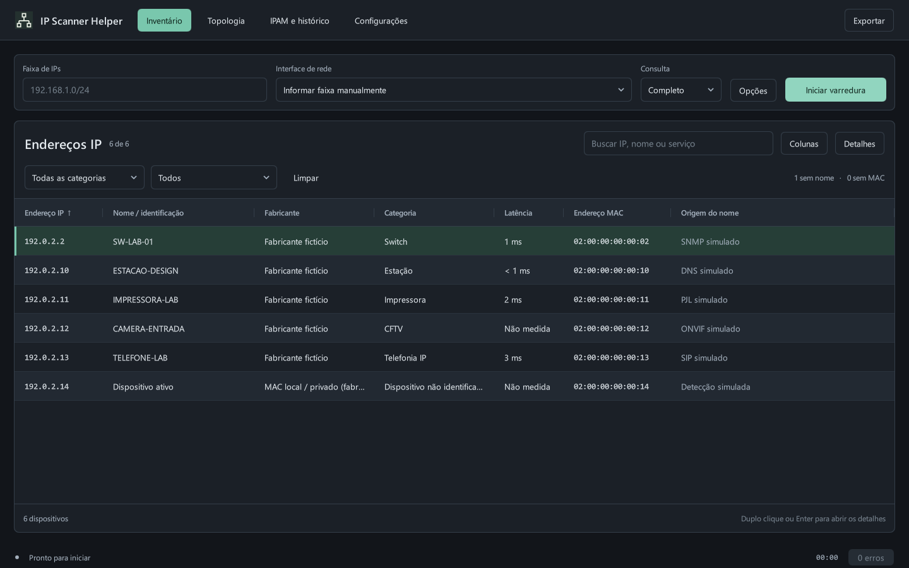
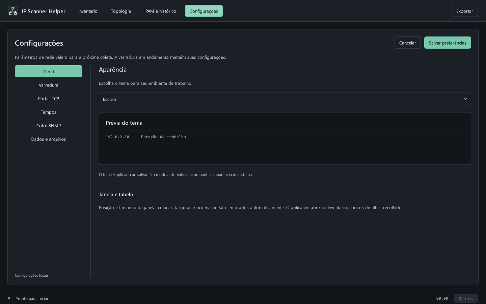
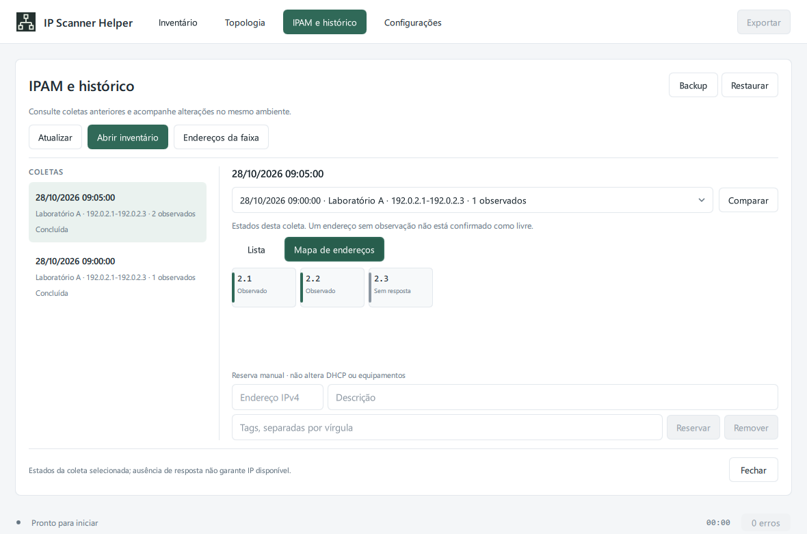

# Navegação e configurações — 2.1.0

O aplicativo abre no **Inventário**, com detalhes recolhidos. Quatro abas ficam
no cabeçalho; a tabela conserva sua largura. Alternar páginas não inicia uma
coleta, não cancela a sessão em andamento e não apaga seleção, filtros ou rolagem.

| Página | Uso |
| --- | --- |
| Inventário | Coleta, tabela de IPs, filtros, ações e detalhes sob demanda |
| Topologia | Mapa nativo interativo do inventário atual, com agrupamento, zoom e arraste |
| IPAM e histórico | Coletas salvas, comparação, endereços da faixa, reservas e tags |
| Configurações | Aparência, parâmetros de rede, perfis, tempos, cofre e arquivos locais |

## Central de configurações

As seções **Geral**, **Varredura**, **Portas TCP**, **Tempos**, **Cofre SNMP** e
**Dados e arquivos** reutilizam os serviços existentes. Os campos de rede valem
para a próxima coleta; opções da sessão ativa permanecem imutáveis.

Salvar valida o rascunho inteiro e persiste antes de aplicar. Falha de validação
ou gravação mantém as preferências anteriores. Cancelar descarta a edição.
Ao navegar ou fechar a janela com alterações, o aplicativo oferece salvar,
descartar ou continuar editando. O cofre mantém suas ações próprias de gravação,
com segredos protegidos por DPAPI e fora do JSON de preferências.

**Dados e arquivos** apresenta os caminhos reais do banco, preferências e log,
permite abrir suas pastas e acessar backup/restauração do banco. Na demonstração,
os recursos pessoais indisponíveis permanecem desabilitados.

## Aparência e migração

Escolha **Claro**, **Escuro** ou **Seguir o sistema** em Geral. O tema é aplicado
ao salvar. A paleta usa cores semânticas para fundos, texto, controles, seleção,
menus e diálogos. O modo automático acompanha o esquema informado pelo Qt ao
Windows, sem editar o Registro; veja [QStyleHints.colorScheme](https://doc.qt.io/qt-6/qstylehints.html#colorScheme-prop).

O `settings.json` passa ao schema **5**, acrescentando apenas `theme` ao contrato.
Schemas 1–4 continuam legíveis e recebem backup exato antes da migração na gravação.
O padrão permanece claro. Versões anteriores que desconheçam o schema 5 o preservam
sem sobrescrever; para retornar aos ajustes antigos, com o aplicativo fechado,
preserve o arquivo atual e restaure o backup do schema compatível.

Demonstração e autoverificação não leem/gravam preferências pessoais. O banco
SQLite não muda de esquema e inventários antigos conservam suas categorias.

## Topologia dentro do aplicativo

O mapa usa o mesmo modelo de nós, grupos e evidências das exportações. O cálculo
de posições em JavaScript é compartilhado com o mapa HTML. Grupos começam
recolhidos, a busca revela correspondências e o painel de equipamento só abre
quando selecionado. **Ver no inventário** abre os detalhes do IP escolhido.

Há agrupamento por categoria/switch, malha, enquadramento, zoom por roda/botões e
arraste. O canvas tem o tamanho do viewport, desenha apenas cartões visíveis e
omite texto em escalas muito pequenas. A atualização é limitada a uma a cada
300 ms enquanto a página está visível. Inventário, histórico e parâmetros de
rede não dependem desse desenho.

Verde representa caminho FDB e azul, relato LLDP/CDP. Categorias não geram cabos.
Relações cujo extremo esteja recolhido não são desenhadas; expanda os grupos ou
use malha para vê-las. **Abrir mapa detalhado** mantém o HTML offline com árvore,
foco animado e navegação sequencial entre switches. O mapa nativo não incorpora
um navegador nem acrescenta dependências WebEngine.

## Mapa de endereços

Em IPAM e histórico, selecione uma coleta e **Endereços da faixa → Mapa de
endereços**. A grade virtualizada usa os estados da sessão: observado, parcial,
sem resposta, não consultado ou reservado manualmente. Clique em uma célula para
preencher o editor de reserva/tags. Nenhum estado de silêncio é convertido em IP
livre, ataque ou equipamento desconhecido confirmado.

## Próximos incrementos

O escopo escolhido para esta entrega foi navegação e central de configurações.
Agenda, bandeja, notificações, inicialização com Windows, escala própria da UI,
regras personalizadas, tentativas de credenciais em cascata, SNMPv3, editor UDP,
retenção/expurgo/VACUUM, webhooks, integrações e visualizador/pacote de diagnóstico
continuam separados. Não há controles que aparentem executar esses recursos.

A homologação em rede autorizada continua pendente. O próximo incremento
funcional recomendado é agendamento local sem sobreposição; notificações só
depois de definir tolerância, comparação de contextos e deduplicação.
